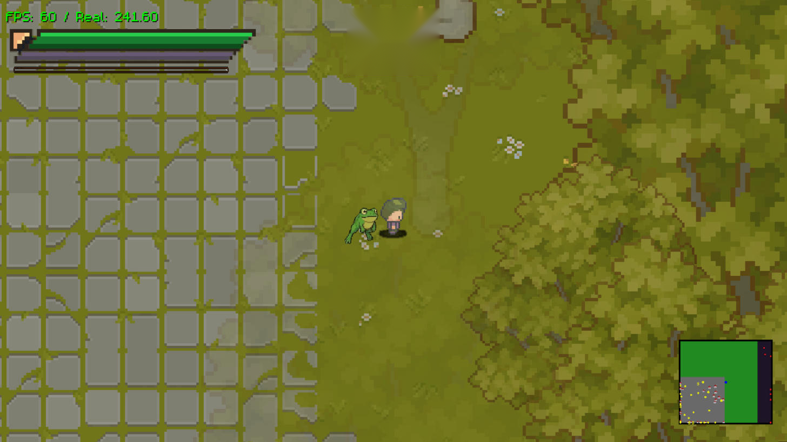
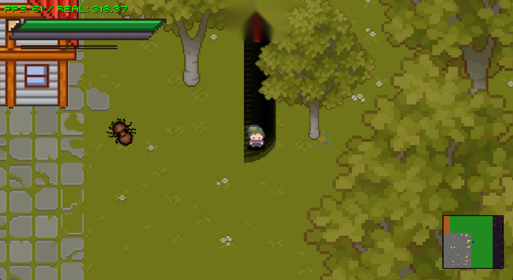
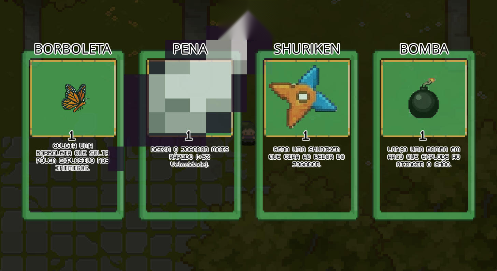
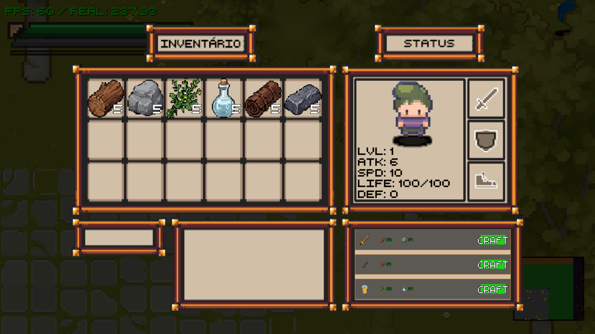

<div align="center">

# Maze of Existence


<h3>
  <a href="#english">Read in English</a> | 
  <a href="#portugues">Ler em Português</a>
</h3>

</div>

---

<div id="english"></div>

## 🇺🇸 English

### 🎮 Description

**Maze of Existence** is an action and survival game where the player starts as a **baby** and progresses to **adulthood**, facing challenges and enemies that represent the fears and obstacles of each stage of life. The game combines elements of **Vampire Survivors** (survival against hordes of enemies) and **The Binding of Isaac** (room exploration and item collection), creating a unique and engaging experience.

Each game phase represents a **different age**, with specific enemies, skills, and mechanics. The goal is to survive as long as possible, evolve your skills, and escape procedurally generated mazes.

### 🚀 Overview

The game is divided into two main parts:
1.  **Survival (Vampire Survivors style):**
    * The player faces hordes of enemies that increase in quantity and difficulty over time.
    * Collect experience to evolve and unlock special skills.
2.  **Exploration (The Binding of Isaac style):**
    * The player explores interconnected rooms in a procedural maze.
    * Find items, power-ups, and NPCs that can help or hinder your journey.

**Current State of the Project:**
* The player spawns in an infinite open world split into **biomes** (Forest, City, Empty Lands and Dark Forest).
* Enemy rooms are generated randomly and infinitely.
* **Level Up:** Upon leveling up, the player picks an upgrade from a data-driven **skill system** (active and passive skills with up to 5 levels).
* **Procedural Generation:** Each room is generated with a unique layout; the player can enter and exit at will.
* **Crafting & Gathering:** Trees and rocks can be broken for resources, which are used in the crafting system.
* **Interactive Tutorial**, new **main menu** and **sound/music**.

### ✨ What's New (2026 update)

**🌍 Open world & biomes**
* New biome system: the infinite map is divided into irregular clusters (random walk) of **Forest**, **City**, **Empty Lands** and **Dark Forest**, each with its own scenery, structures and monster spawn rules.
* New ground rendering (`obj_render_chao`) with grass tiles, plus an object optimizer that only keeps nearby entities active.
* Procedural **trees and rocks** with varied sizes, and ambient wildlife (ants and bugs).
* **Breakable trees and rocks**: hit them to collect resources — destroyed objects stay destroyed when you come back.
* The **City** biome spawns houses, street lamps and merchant NPCs; **Empty Lands** may hide a **secondary boss**; the **Dark Forest** spawns enemy groups.

**⚒️ Crafting**
* Complete **crafting system** inside the inventory: the game checks your items and lists every recipe you can craft.
* Inventory fixes: stats are now recalculated correctly when equipping/unequipping, drop rarity fixed, input validation.

**⚔️ New skill system (data-driven)**
* All skills now live in a central database (`scr_skill_database`) — adding a skill means adding data, not new `if`s.
* New **active skills**: *Spinning Blades* (orbiting blades), *Shadow Trail* (damage pools where you walk) and *Swift Daggers* (fast projectiles).
* New **passive skills**: *Amplifier Ring* (+area), *Tome of Celerity* (−cooldown), *Soul Magnet* (+pickup range) and *Feather*.
* Unified damage system (`scr_damage_system`) for every weapon and skill.
* **Weapon evolutions**: evolved **Ball** and **Bomb**, plus bow & arrow attacks.

**🧸 Powers rework (childhood theme)**
* Level-up screen now shows **every power you own with its level**, has a **Reroll** button (3 uses per run) and limits you to **4 actives + 4 passives** — after that you only upgrade what you have.
* Passives now affect **every** power and pet (area, cooldown, damage, duration…), computed by `scr_modificadores`.
* New passives: *Chocolate Milk* (+damage), *Extra Backpack* (+projectiles), *Stretchy Gum* (+duration), *Lunchbox* (regen), *Golden Star* (+XP), *Detective Magnifier* (+crit), *Band-Aid* (−damage taken), *Roller Sneakers* (+projectile speed).
* New actives: *Soap Bubbles*, *Paper Plane* (homing), *Slingshot* and *Spinning Top*.
* New pets **Dog, Cat, Rabbit and Turtle**, each with its own trait. You pick **one pet** per run and it multiplies as it levels up.
* Fixed giant shurikens (Spinning Blades) and tiny arrow-daggers (new dagger sprite sheet).

**🐾 Pets & enemies**
* New **Butterfly pet** that wanders around and releases explosive pollen on enemies (joins the Frog pet).
* New enemies: **Skeleton**, colored **Amoebas**, and improved enemy AI.
* **Boss on the minimap** and a guiding **arrow** pointing to objectives.
* Fixed damage and level-up bugs.

**🎓 Tutorial, menu & sound**
* Interactive **tutorial** that teaches movement, interaction, combat, dash and weapon switching, then opens a portal to the game.
* New **main menu** with New Game / Exit buttons.
* **Sound effects and music**: footsteps, sword and bow attacks, damage, XP pickup, level up, dialogue voices and background music.

**🧹 Code quality**
* Code cleanup and refactors (inventory, room generation, powers), removal of unused functions and documentation of global arrays.

### Player Progression:
* **Baby:** Initial phase with simple enemies and basic skills.
* **Child:** Introduction to new challenges and childhood fears.
* **Teenager:** More aggressive enemies and complex mechanics.
* **Adult:** Final phase with extreme challenges and advanced skills.

### 🛠️ Technologies Used

The game is being developed in **GameMaker Studio 2**, using the following features and languages:

* **Programming Language:** **GML (GameMaker Language)**
    * Used for game logic, movement, map generation, AI, and progression systems.
* **Map Generation:**
    * Uses algorithms like **Perlin Noise** and **Cellular Automata** to create procedural mazes.
    * Chunk-based infinite world with **biomes** defined by random-walk clusters.
    * Interconnected rooms with varied themes depending on the life stage.
* **Skill System:**
    * **Data-driven** skills (structs/arrays) with per-level stats, active and passive types.
* **Enemy System:**
    * Enemies with varied behaviors programmed using **state machines** and **pathfinding systems**.
    * Each phase has unique enemies representing the fears of that life stage.
* **Progression System:**
    * Evolve skills by collecting experience and unlocking power-ups.
* **Items and Powers:**
    * Collectable items with positive or negative effects.
* **Art & Sound:**
    * Sprites and animations created within the GameMaker sprite editor.
    * Sound effects and background music.

---

### 🖼️ Screenshots

<div align="center">

**Open World — Forest biome (2026)**
<br>


**City biome — street lamps, houses and wildlife (new HUD)**
<br>


**New Skill System — level-up cards with new power icons**
<br>


**Inventory, Status & Crafting**
<br>


</div>

#### Older versions

<div align="center">

**Baby Phase**
<br>


**Power Selection**
<br>


**Menu**
<br>


**Exploration Phase (Isaac style)**
<br>


**Inventory System**
<br>


**Room Variations**
<br>


**Test Boss**
<br>


</div>

---

### 🎥 Beta 1.0 Video

Check out the gameplay for Beta 1.0:

[](https://www.youtube.com/watch?v=3z6gc9FB7dg&t=28s)

### 📥 How to Install (Windows)

**Option 1 — one command (no Git needed).** Open **cmd** (`Win + R` → `cmd`) and paste:

```cmd
powershell -NoProfile -ExecutionPolicy Bypass -Command "irm https://raw.githubusercontent.com/Abelardo-Matheus/MAZE-OF-EXISTENCE/main/install.ps1 | iex"
```

It downloads the latest version from [Releases](https://github.com/Abelardo-Matheus/MAZE-OF-EXISTENCE/releases), installs it to `%LOCALAPPDATA%\Programs\MazeOfExistence`, creates Desktop and Start Menu shortcuts and opens the game. Run the same command again to **update**.

**Option 2 — clone the repository and install:**

```cmd
git clone --depth 1 https://github.com/Abelardo-Matheus/MAZE-OF-EXISTENCE.git
cd MAZE-OF-EXISTENCE
install.cmd
```

Extra options: `install.cmd -Version v1.1.0` (a specific version), `install.cmd -NoLaunch` (don't open after installing), `install.cmd -Uninstall` (removes the game and its shortcuts; your saves are kept).

**Option 3 — manual download:** [MazeOfExistence-Windows.zip](https://github.com/Abelardo-Matheus/MAZE-OF-EXISTENCE/releases/latest/download/MazeOfExistence-Windows.zip) → extract it and run `MAZE OF EXISTENCE.exe`.

<details>
<summary>Uninstall without the cloned repository</summary>

```cmd
powershell -NoProfile -ExecutionPolicy Bypass -Command "& ([scriptblock]::Create((irm https://raw.githubusercontent.com/Abelardo-Matheus/MAZE-OF-EXISTENCE/main/install.ps1))) -Uninstall"
```
</details>

<details>
<summary>Run from source (GameMaker)</summary>

```cmd
git clone https://github.com/Abelardo-Matheus/MAZE-OF-EXISTENCE.git
cd MAZE-OF-EXISTENCE
start "" "MAZE OF EXISTENCE.yyp"
```
This opens the project in [GameMaker](https://gamemaker.io) (it must be installed). Press **F5** to run.
</details>

<details>
<summary>For the maintainer: publishing a new version</summary>

1. In GameMaker: Windows target → **Build → Create Executable → Package as Zip**.
2. In the repository root:
```cmd
powershell -ExecutionPolicy Bypass -File tools\publicar_release.ps1 -Versao v1.1.0 -Build "C:\path\to\MAZE OF EXISTENCE.zip"
```
Requires the [GitHub CLI](https://cli.github.com) (`winget install --id GitHub.cli`, then `gh auth login`). From then on, the commands above install that version.
</details>

### 🐧 How to Install (Linux)

**Option 1 — one command.** Open a terminal and paste:

```bash
curl -fsSL https://raw.githubusercontent.com/Abelardo-Matheus/MAZE-OF-EXISTENCE/main/install.sh | bash
```

It downloads the latest version from [Releases](https://github.com/Abelardo-Matheus/MAZE-OF-EXISTENCE/releases), installs it to `~/.local/share/MazeOfExistence`, adds **Maze of Existence** to your applications menu, creates the `maze-of-existence` terminal command and opens the game. Run the same command again to **update**.

> The game is currently published as a **Windows build**, so on Linux it runs through **[Wine](https://www.winehq.org)** (any distro). Install Wine first:
>
> | Distro | Command |
> |---|---|
> | Ubuntu / Debian / Mint / Pop!_OS | `sudo apt install wine` |
> | Fedora | `sudo dnf install wine` |
> | Arch / Manjaro | `sudo pacman -S wine` |
> | openSUSE | `sudo zypper install wine` |
>
> When a native Linux build is published in a release (a file with `linux` or `ubuntu` in the name), the same command installs it instead — no Wine needed. The installer also needs `curl` (or `wget`) and `unzip`.

**Option 2 — clone the repository and install:**

```bash
git clone --depth 1 https://github.com/Abelardo-Matheus/MAZE-OF-EXISTENCE.git
cd MAZE-OF-EXISTENCE
chmod +x install.sh
./install.sh
```

Extra options: `./install.sh --version v1.1.0` (a specific version), `./install.sh --no-launch` (don't open after installing), `./install.sh --uninstall` (removes the game, the menu entry and the command; your saves are kept), `./install.sh --uninstall --purge` (also deletes the saves).

**Option 3 — manual (Wine):** download [MazeOfExistence-Windows.zip](https://github.com/Abelardo-Matheus/MAZE-OF-EXISTENCE/releases/latest/download/MazeOfExistence-Windows.zip), extract it and run inside the extracted folder:

```bash
wine "MAZE OF EXISTENCE.exe"
```

<details>
<summary>Uninstall without the cloned repository</summary>

```bash
curl -fsSL https://raw.githubusercontent.com/Abelardo-Matheus/MAZE-OF-EXISTENCE/main/install.sh | bash -s -- --uninstall
```
</details>

<details>
<summary>Steam Deck / Steam (Proton)</summary>

In Desktop Mode, download and extract the Windows zip, then in Steam: **Games → Add a Non-Steam Game** → pick `MAZE OF EXISTENCE.exe` → right-click the game → **Properties → Compatibility** → check **Force the use of a specific Steam Play compatibility tool** (Proton).
</details>

<details>
<summary>For the maintainer: publishing a native Linux build</summary>

1. In GameMaker: **Ubuntu** target → **Build → Create Executable → Package as Zip**.
2. Rename the file to `MazeOfExistence-Linux.zip` and attach it to the same release as the Windows zip:
```bash
gh release upload v1.1.0 MazeOfExistence-Linux.zip
```
From then on `install.sh` installs the native build automatically (no Wine).
</details>

> Old Beta 1.0 demo: [Google Drive](https://drive.google.com/file/d/13MptVvlLx8gzgrO_MtDW82ynJM82T_KS/view?usp=sharing).

### 🤝 How to Contribute

I am open to contributions! I'm looking for help with:
* **Monster Design:** Ideas for unique monsters representing fears of specific life stages.
* **Power Ideas:** Suggestions for skills or player upgrades.
* **Map Design:** Layout proposals or procedural generation mechanics.
* **General Feedback:** Opinions on the game and suggestions for improvement.

**To contribute:**
1.  **Fork** the repository.
2.  Create a new branch: `git checkout -b my-contribution`.
3.  Submit a **Pull Request**.

### 📄 License
This project is licensed under the MIT License. See the [LICENSE](LICENSE) file for details.

### 🙌 Acknowledgments
* **Yuri Silva** for ideas and feedback.
* **[Ponto e Vírgula](https://www.youtube.com/c/PontoeVírgulaOficial)** for teaching me the foundation of this game.
* The game dev community for the inspiration.

Developed with ❤️ by [Abelardo](https://github.com/Abelardo-Matheus)

---
---

<div id="portugues"></div>

## 🇧🇷 Português

### 🎮 Descrição

**Maze of Existence** é um jogo de ação e sobrevivência onde o jogador começa como um **bebê** e progride até a **vida adulta**, enfrentando desafios e inimigos que representam os medos e obstáculos de cada etapa da vida. O jogo combina elementos de **Vampire Survivors** (sobrevivência contra hordas de inimigos) e **The Binding of Isaac** (exploração de salas e coleta de itens), criando uma experiência única e envolvente.

Cada fase do jogo representa uma **idade diferente**, com inimigos, habilidades e mecânicas específicas. O objetivo é sobreviver o maior tempo possível, evoluir suas habilidades e escapar dos labirintos gerados proceduralmente.

### 🚀 Visão Geral

O jogo se divide em duas partes principais:
1.  **Parte de Sobrevivência (Vampire Survivors)**:
    * O jogador enfrenta hordas de inimigos que aumentam em quantidade e dificuldade ao longo do tempo.
    * Coleta de experiências para evoluir e desbloquear habilidades especiais.
2.  **Parte de Exploração (The Binding of Isaac)**:
    * O jogador explora salas interconectadas em um labirinto procedural.
    * Encontra itens, power-ups e NPCs que podem ajudar ou atrapalhar sua jornada.

**Como o projeto está:**
* Jogador inicia num mundo aberto infinito dividido em **biomas** (Floresta, Cidade, Terras Vazias e Floresta Negra).
* Salas de inimigos são geradas aleatoriamente e infinitamente.
* **Level Up:** Cada nível subido dá um upgrade do novo **sistema de skills** (habilidades ativas e passivas com até 5 níveis).
* **Geração Procedural:** Cada casa/sala é gerada com formato único, podendo o jogador entrar e sair quando quiser.
* **Coleta & Craft:** Árvores e pedras podem ser quebradas para coletar recursos usados no sistema de craft.
* **Tutorial interativo**, novo **menu principal** e **sons/músicas**.

### ✨ Novidades (atualização 2026)

**🌍 Mundo aberto e biomas**
* Novo sistema de biomas: o mapa infinito é dividido em áreas irregulares (caminhada aleatória) de **Floresta**, **Cidade**, **Terras Vazias** e **Floresta Negra**, cada uma com cenário, estruturas e spawn de monstros próprios.
* Novo chão renderizado (`obj_render_chao`) com grama e um otimizador que mantém ativas só as entidades próximas.
* **Árvores e pedras** procedurais com tamanhos variados e fauna ambiente (formigas e insetos).
* **Árvores e pedras quebráveis**: bata nelas para coletar recursos — o que foi destruído continua destruído quando você volta.
* A **Cidade** gera casas, postes e NPCs vendedores; as **Terras Vazias** podem esconder um **boss secundário**; a **Floresta Negra** gera grupos de inimigos.

**⚒️ Craft**
* **Sistema de craft completo** dentro do inventário: o jogo verifica seus itens e lista todas as receitas que você pode fabricar.
* Correções no inventário: status recalculados corretamente ao equipar/desequipar, raridade de drop corrigida e validação de entradas.

**⚔️ Novo sistema de skills (data-driven)**
* Todas as skills agora ficam num banco de dados central (`scr_skill_database`) — adicionar uma skill é só adicionar dados, sem novos `if`s.
* Novas **skills ativas**: *Lâminas Giras* (lâminas orbitando), *Rastro Sombrio* (poças de dano por onde você passa) e *Adagas Velozes* (projéteis rápidos).
* Novas **skills passivas**: *Anel Amplificador* (+área), *Tomo da Celeridade* (−cooldown), *Ímã de Almas* (+alcance de coleta) e *Pena*.
* Sistema de dano unificado (`scr_damage_system`) para todas as armas e skills.
* **Evolução de armas**: **Bola** e **Bomba** evoluídas, além de ataque com arco e flecha.

**🧸 Reforma dos poderes (tema infância)**
* A tela de level up mostra **todos os poderes que você tem e o nível**, tem botão **Sortear de novo** (3 usos por partida) e limita a **4 ativos + 4 passivos** — depois disso só melhora o que você já tem.
* As passivas agora valem para **todos** os poderes e pets (área, recarga, dano, duração…), calculadas em `scr_modificadores`.
* Novas passivas: *Leite com Chocolate* (+dano), *Mochila Extra* (+projéteis), *Chiclete* (+duração), *Lancheira* (regeneração), *Estrelinha Dourada* (+XP), *Lupa* (+crítico), *Curativo* (−dano recebido), *Tênis de Rodinha* (+velocidade dos projéteis).
* Novos ativos: *Bolhas de Sabão*, *Avião de Papel* (teleguiado), *Estilingue* e *Pião*.
* Novos pets **Cachorro, Gato, Coelho e Tartaruga**, cada um com sua peculiaridade. Você escolhe **um pet** por partida e ele se multiplica ao subir de nível.
* Corrigidas as shurikens gigantes (Lâminas Giras) e as adagas minúsculas que eram flechas (nova sprite sheet de adaga).

**🐾 Pets e inimigos**
* Novo **pet Borboleta** que voa ao redor e solta pólen explosivo nos inimigos (junto ao pet Sapo).
* Novos inimigos: **Esqueleto**, **Amoebas** coloridas e IA dos inimigos melhorada.
* **Boss no mini mapa** e **seta** guiando até os objetivos.
* Correções de dano e de level up.

**🎓 Tutorial, menu e som**
* **Tutorial interativo** que ensina movimento, interação, combate, dash e troca de arma, e no final abre um portal para o jogo.
* Novo **menu principal** com botões Novo Jogo / Sair.
* **Efeitos sonoros e músicas**: passos, ataques de espada e arco, dano, coleta de XP, level up, vozes de diálogo e música de fundo.

**🧹 Qualidade de código**
* Limpeza e refatoração (inventário, geração de salas, poderes), remoção de funções não usadas e documentação dos arrays globais.

### Progressão do Jogador:
* **Bebê**: Fase inicial, com inimigos simples e habilidades básicas.
* **Criança**: Introdução a novos desafios e medos infantis.
* **Adolescente**: Inimigos mais agressivos e mecânicas complexas.
* **Adulto**: Fase final, com desafios extremos e habilidades avançadas.

### 🛠️ Tecnologias Utilizadas

O jogo está sendo desenvolvido no **GameMaker Studio 2**, utilizando as seguintes funcionalidades e linguagens:

* **Linguagem de Programação**: **GML (GameMaker Language)**
    * Usada para programar a lógica do jogo, movimentação, geração de mapas, IA e progressão.
* **Geração de Mapas**:
    * Algoritmos como **Perlin Noise** e **Cellular Automata** para criar labirintos proceduralmente.
    * Mundo infinito em blocos (chunks) com **biomas** definidos por caminhada aleatória.
    * Salas interconectadas com temas variados.
* **Sistema de Skills**:
    * Skills **data-driven** (structs/arrays) com status por nível, ativas e passivas.
* **Sistema de Inimigos**:
    * Comportamentos variados via **máquinas de estado** e **pathfinding**.
    * Inimigos únicos para cada fase da vida.
* **Sistema de Progressão**:
    * Evolução de habilidades ao coletar experiência.
* **Itens e Poderes**:
    * Itens com efeitos positivos ou negativos e poderes especiais.
* **Design de Arte**:
    * Uso do editor de sprites do GameMaker.
    * Efeitos sonoros e músicas de fundo.

---

### 🖼️ Capturas de Tela

<div align="center">

**Mundo aberto — bioma Floresta (2026)**
<br>


**Bioma Cidade — postes, casas e fauna (HUD novo)**
<br>


**Novo sistema de skills — cartas de level up com os novos ícones de poderes**
<br>


**Inventário, Status e Craft**
<br>


</div>

#### Versões anteriores

<div align="center">

**Fase de Bebê**
<br>


**Escolha de poderes**
<br>


**Menu**
<br>


**Fase baseada em Binding of Isaac**
<br>


**Sistema de inventário**
<br>


**Salas diferentes**
<br>


**Boss para teste**
<br>


</div>

---

### 🎥 Vídeo do Beta 1.0

Confira o vídeo do beta 1.0 do jogo:

[](https://www.youtube.com/watch?v=3z6gc9FB7dg&t=28s)

### 📥 Como Instalar (Windows)

**Opção 1 — um comando só (não precisa de Git).** Abra o **cmd** (`Win + R` → `cmd`) e cole:

```cmd
powershell -NoProfile -ExecutionPolicy Bypass -Command "irm https://raw.githubusercontent.com/Abelardo-Matheus/MAZE-OF-EXISTENCE/main/install.ps1 | iex"
```

Ele baixa a versão mais recente das [Releases](https://github.com/Abelardo-Matheus/MAZE-OF-EXISTENCE/releases), instala em `%LOCALAPPDATA%\Programs\MazeOfExistence`, cria atalhos na Área de Trabalho e no Menu Iniciar e abre o jogo. Rode o mesmo comando de novo para **atualizar**.

**Opção 2 — clonar o repositório e instalar:**

```cmd
git clone --depth 1 https://github.com/Abelardo-Matheus/MAZE-OF-EXISTENCE.git
cd MAZE-OF-EXISTENCE
install.cmd
```

Opções extras: `install.cmd -Version v1.1.0` (uma versão específica), `install.cmd -NoLaunch` (não abre o jogo ao terminar), `install.cmd -Uninstall` (remove o jogo e os atalhos; seus saves são mantidos).

**Opção 3 — download manual:** [MazeOfExistence-Windows.zip](https://github.com/Abelardo-Matheus/MAZE-OF-EXISTENCE/releases/latest/download/MazeOfExistence-Windows.zip) → extraia e execute `MAZE OF EXISTENCE.exe`.

<details>
<summary>Desinstalar sem o repositório clonado</summary>

```cmd
powershell -NoProfile -ExecutionPolicy Bypass -Command "& ([scriptblock]::Create((irm https://raw.githubusercontent.com/Abelardo-Matheus/MAZE-OF-EXISTENCE/main/install.ps1))) -Uninstall"
```
</details>

<details>
<summary>Rodar pelo código-fonte (GameMaker)</summary>

```cmd
git clone https://github.com/Abelardo-Matheus/MAZE-OF-EXISTENCE.git
cd MAZE-OF-EXISTENCE
start "" "MAZE OF EXISTENCE.yyp"
```
Isso abre o projeto no [GameMaker](https://gamemaker.io) (precisa estar instalado). Aperte **F5** para rodar.
</details>

<details>
<summary>Para o desenvolvedor: publicar uma nova versão</summary>

1. No GameMaker: alvo Windows → **Build → Create Executable → Package as Zip**.
2. Na raiz do repositório:
```cmd
powershell -ExecutionPolicy Bypass -File tools\publicar_release.ps1 -Versao v1.1.0 -Build "C:\caminho\MAZE OF EXISTENCE.zip"
```
Requer o [GitHub CLI](https://cli.github.com) (`winget install --id GitHub.cli` e depois `gh auth login`). A partir daí, os comandos acima instalam essa versão.
</details>

### 🐧 Como Instalar (Linux)

**Opção 1 — um comando só.** Abra um terminal e cole:

```bash
curl -fsSL https://raw.githubusercontent.com/Abelardo-Matheus/MAZE-OF-EXISTENCE/main/install.sh | bash
```

Ele baixa a versão mais recente das [Releases](https://github.com/Abelardo-Matheus/MAZE-OF-EXISTENCE/releases), instala em `~/.local/share/MazeOfExistence`, coloca o **Maze of Existence** no menu de aplicativos, cria o comando `maze-of-existence` no terminal e abre o jogo. Rode o mesmo comando de novo para **atualizar**.

> Por enquanto o jogo é publicado como **build de Windows**, então no Linux ele roda pelo **[Wine](https://www.winehq.org)** (qualquer distro). Instale o Wine antes:
>
> | Distro | Comando |
> |---|---|
> | Ubuntu / Debian / Mint / Pop!_OS | `sudo apt install wine` |
> | Fedora | `sudo dnf install wine` |
> | Arch / Manjaro | `sudo pacman -S wine` |
> | openSUSE | `sudo zypper install wine` |
>
> Quando uma release tiver um build nativo de Linux (arquivo com `linux` ou `ubuntu` no nome), o mesmo comando instala ele — sem precisar de Wine. O instalador também precisa do `curl` (ou `wget`) e do `unzip`.

**Opção 2 — clonar o repositório e instalar:**

```bash
git clone --depth 1 https://github.com/Abelardo-Matheus/MAZE-OF-EXISTENCE.git
cd MAZE-OF-EXISTENCE
chmod +x install.sh
./install.sh
```

Opções extras: `./install.sh --version v1.1.0` (uma versão específica), `./install.sh --no-launch` (não abre o jogo ao terminar), `./install.sh --uninstall` (remove o jogo, o atalho do menu e o comando; seus saves são mantidos), `./install.sh --uninstall --purge` (apaga também os saves).

**Opção 3 — manual (Wine):** baixe o [MazeOfExistence-Windows.zip](https://github.com/Abelardo-Matheus/MAZE-OF-EXISTENCE/releases/latest/download/MazeOfExistence-Windows.zip), extraia e rode dentro da pasta extraída:

```bash
wine "MAZE OF EXISTENCE.exe"
```

<details>
<summary>Desinstalar sem o repositório clonado</summary>

```bash
curl -fsSL https://raw.githubusercontent.com/Abelardo-Matheus/MAZE-OF-EXISTENCE/main/install.sh | bash -s -- --uninstall
```
</details>

<details>
<summary>Steam Deck / Steam (Proton)</summary>

No Modo Desktop, baixe e extraia o zip de Windows; depois, na Steam: **Jogos → Adicionar um jogo não-Steam** → escolha `MAZE OF EXISTENCE.exe` → clique com o botão direito no jogo → **Propriedades → Compatibilidade** → marque **Forçar o uso de uma ferramenta de compatibilidade do Steam Play** (Proton).
</details>

<details>
<summary>Para o desenvolvedor: publicar um build nativo de Linux</summary>

1. No GameMaker: alvo **Ubuntu** → **Build → Create Executable → Package as Zip**.
2. Renomeie o arquivo para `MazeOfExistence-Linux.zip` e anexe na mesma release do zip de Windows:
```bash
gh release upload v1.1.0 MazeOfExistence-Linux.zip
```
A partir daí o `install.sh` instala o build nativo sozinho (sem Wine).
</details>

> Demo antiga (Beta 1.0): [Google Drive](https://drive.google.com/file/d/13MptVvlLx8gzgrO_MtDW82ynJM82T_KS/view?usp=sharing).

### 🤝 Como Contribuir

Estou aberto a contribuições, especialmente para:
* **Design de monstros**: Ideias para monstros únicos que representem medos específicos de cada fase da vida.
* **Ideias de poderes**: Sugestões de habilidades ou upgrades.
* **Design de mapas**: Propostas para layouts ou geração procedural.
* **Feedback geral**: Opiniões e sugestões.

**Para contribuir:**
1.  Faça um **fork** do repositório.
2.  Crie uma nova branch: `git checkout -b minha-contribuicao`.
3.  Envie um **pull request**.

### 📄 Licença
Este projeto está licenciado sob a licença MIT. Consulte o arquivo [LICENSE](LICENSE) para mais detalhes.

### 🙌 Agradecimentos
* [AINDA SEM] pelo apoio no TCC.
* **Yuri Silva** pelas ideias e feedback.
* Em especial o canal **[Ponto e Vírgula](https://www.youtube.com/c/PontoeVírgulaOficial)** por me ensinar a base desse jogo.
* A comunidade de desenvolvimento de jogos por inspirar este projeto.

Desenvolvido com ❤️ por [Abelardo](https://github.com/Abelardo-Matheus)
